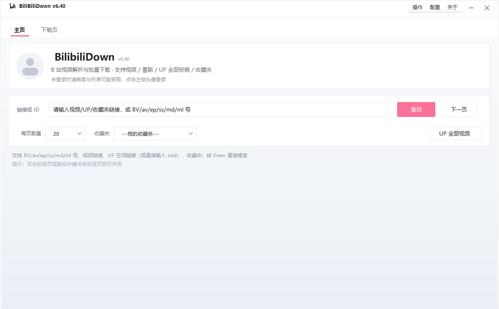
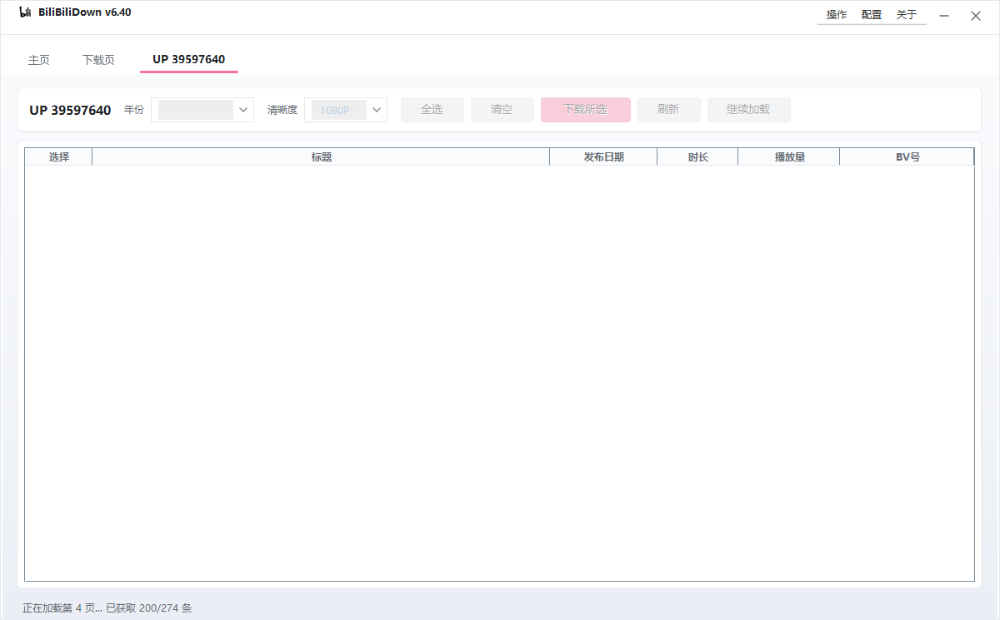
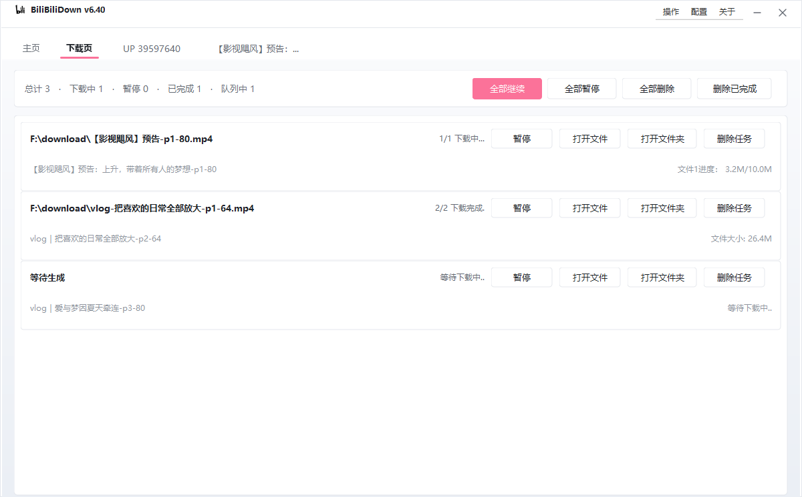

# BilibiliDown 中文说明

[English README](README.md) ｜ 中文说明

基于 Java / Swing 的 B 站视频下载器：支持单视频、番剧、**某个 UP 的全部投稿**、收藏夹与稍后再看，
可自选清晰度、批量下载，并配有重新设计的现代界面。

> 本项目是 [nICEnnnnnnnLee/BilibiliDown](https://github.com/nICEnnnnnnnLee/BilibiliDown) 的 fork：
> 保留原有下载内核，新增界面重设计、更稳健的投稿列表抓取、UP 全部视频批量下载与清晰度自动降级。
> 沿用上游的 Apache-2.0 协议。

## 截图

| 主页 | UP 全部视频 |
| --- | --- |
|  |  |
| **视频详情** | **下载页** |
|  |  |

## 功能

- 支持 BV / av / ep / ss / md / ml 号、视频链接、UP 空间链接（或直接输入 mid）。
- **UP 全部视频**：一次加载某 UP 的全部公开投稿，按年份筛选、按日期排序、勾选后一键加入下载队列，
  上千条投稿也能流畅操作；勾选状态在切换年份时不丢失。
- **限流友好**：B 站投稿列表接口易触发 `-799` / `HTTP 412`，程序会限速、退避重试、保留已抓取数据，
  并支持「继续加载」从断点续拉。
- 清晰度可选；期望清晰度不可用时默认自动降级（`bilibili.download.quality.autoFallback`）。
- 二维码 / 短信 / 密码登录，凭证保存在本地 `config/` 目录。
- 支持通过 `batchDownload.config` 做定时/无人值守批量下载。
- Windows / macOS / Linux 通用，JRE 8+ 即可运行。

## 快速开始

1. 下载或克隆本仓库。
2. 运行 `release/` 下的启动脚本：
   - Windows：双击 `Double-Click-to-Run-for-Win.bat`（排查问题用 `...-debug.bat` 保留控制台输出）。
   - macOS：`Double-Click-to-Run-for-Mac.command`。
   - Linux：`java -jar release/INeedBiliAV.jar`，或使用 `release/BilibiliDown.desktop`。
3. 在输入框粘贴链接/ID，按回车或点「查找」。

## 使用说明

详细图文说明见 [USAGE_UP_ALL.md](USAGE_UP_ALL.md)，要点：

- **单视频/番剧**：粘贴视频链接或 BV 号即可，在视频页选择清晰度下载。
- **UP 全部视频**：粘贴 `https://space.bilibili.com/<mid>` 或直接输入 mid，点「UP 全部视频」，
  加载完成后勾选 → 选清晰度 → 「下载所选」。
- 也可用 `https://space.bilibili.com/<mid>/video?full=1` 走 `arc/search` 解析（每页 50 条，
  会为每个视频额外请求详情，较慢且更易限流）。
- 遇到「请求过于频繁 / 触发风控」时：稍等后点「继续加载」，或先登录，或把
  `bilibili.download.period.between.query` 调大（如 `1000`）。

## 配置

配置文件位于 `config/app.config`（首次运行自动生成）。常用项：

| 配置项 | 默认值 | 说明 |
| --- | --- | --- |
| `bilibili.savePath` | `download/` | 下载保存目录。 |
| `bilibili.pageSize` | `20` | 列表每页条数。 |
| `bilibili.menu.download.qn` | `1080P` | 批量下载优先清晰度。 |
| `bilibili.download.quality.autoFallback` | `true` | 清晰度不可用时是否自动降级。 |
| `bilibili.download.period.between.query` | `0` | 查询任务之间的间隔（毫秒），限流时调大。 |
| `bilibili.download.poolSize` | `3` | 同时下载数。 |
| `bilibili.ffmpegPath` | `ffmpeg` | ffmpeg 路径。 |

如需自定义背景，把图片放到 `config/background.png`；删除即恢复默认渐变背景。

## 从源码构建

项目使用 `javac` + `jar`，无 Maven/Gradle：

```bash
# Linux / macOS
./package.sh
./.github/scripts/package_launcher.sh   # 可选：低内存启动器 launch.jar
```

```bat
:: Windows
package.bat
```

产物为 `INeedBiliAV.jar`，复制到 `release/` 目录即可配合启动脚本使用；目标字节码为 Java 8。

## 目录结构

```
src/                 Java 源码（引擎、解析器、界面）
src-launcher/        低内存启动器（launch.jar）
libs/                依赖库（zxing、javax.mail、JAF）
release/             可直接运行的目录（启动脚本、jar、ffmpeg、预览图）
src/resources/       内置默认配置与资源
.github/workflows/   CI：构建、打包、发布
```

## 第三方组件

- [JSON.org](https://github.com/stleary/JSON-java)（MIT）— JSON 解析
- [zxing](https://github.com/zxing/zxing)（Apache-2.0）— 二维码生成
- [ffmpeg](http://www.ffmpeg.org) — 转码/合并（外部程序）
- [geetest-validator](https://github.com/kuresaru/geetest-validator) — 验证码辅助
- AV/BV 转换参考 [Colerar/abv](https://github.com/Colerar/abv)（MIT）
- Cookie 刷新 wasm 逆向参考
  [SocialSisterYi/bilibili-API-collect#524](https://github.com/SocialSisterYi/bilibili-API-collect/issues/524)

## 协议与免责声明

本项目采用 [Apache License 2.0](LICENSE)。与 B 站官方无关。
请仅用于个人合法用途，遵守 B 站用户协议并尊重创作者权益，不要传播下载的内容。
